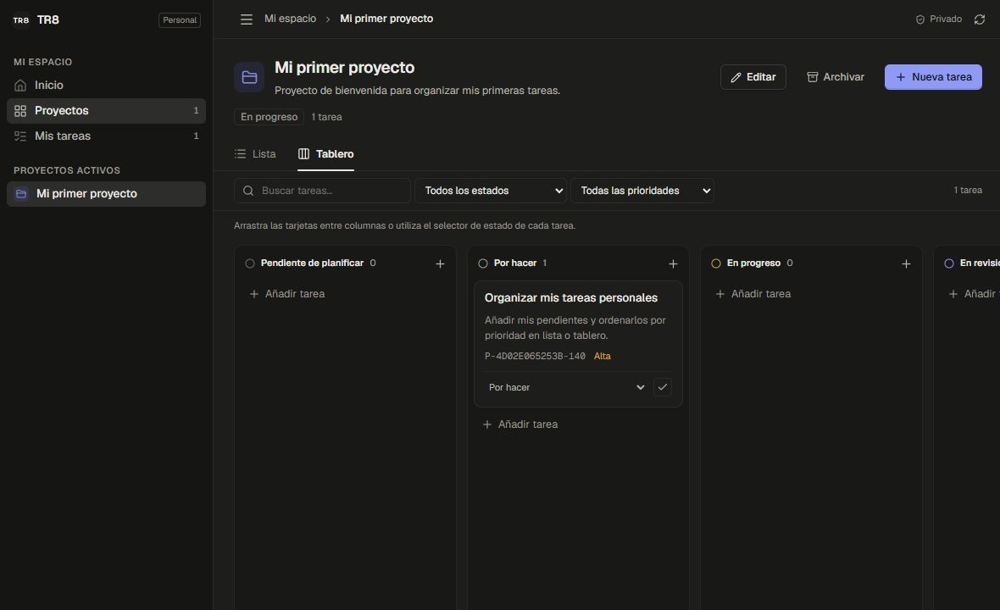

# TR8 · Personal

Aplicación personal de proyectos y tareas con React, TypeScript y Supabase. Conserva los colores, la tipografía, la navegación y los componentes visuales del prototipo original de [Gr8r Studio](https://github.com/gr8rstudio/gr8r-studio).

La marca es **TR8** y el identificador de proyectos y plataformas es `tr8`.
`tr8.studio` es el dominio previsto para una compra futura.



## Primer entregable

- Cuenta personal: registro, confirmación del correo, inicio/cierre de sesión y recuperación de contraseña con Supabase Auth.
- Proyectos: crear, editar, archivar y restaurar.
- Tareas: crear, editar, eliminar, completar y cambiar de estado; descripción, prioridad y fechas opcionales.
- Lista y tablero sobre los mismos datos, con búsqueda y filtros. El tablero permite arrastrar tareas entre estados; el selector ofrece una alternativa con teclado.
- Inicio con resumen y próximos vencimientos. Los datos se guardan en Postgres y se recuperan al volver a entrar.
- Acceso restringido al propietario confirmado, también en la base de datos mediante RLS.

Esta versión se centra en el uso personal. Equipos, archivos adjuntos, calendario, notificaciones y colaboración quedan fuera de este entregable.

## Desarrollo local

Requiere Node.js **22.12 o posterior** y npm. Usa un solo gestor de paquetes; `package-lock.json` es el archivo de bloqueo del proyecto.

```bash
npm ci
cp .env.example .env.local
```

En PowerShell, el segundo comando puede escribirse como `Copy-Item .env.example .env.local`. Completa las variables de `.env.local` con la URL y la clave **publishable** del proyecto de Supabase, y el correo del propietario. Este archivo está ignorado por Git. Las variables `VITE_*` llegan al navegador: nunca pongas allí una clave `service_role`, `sb_secret_*` ni una contraseña.

```bash
npm run dev -- --host 127.0.0.1 --port 5173 --strictPort
```

Abre [la aplicación local](http://127.0.0.1:5173/). Si falta la configuración, la aplicación muestra una pantalla de configuración pendiente; no sustituye los datos por ejemplos.

```bash
npm run typecheck
npm test
npm run test:database:static
npm run lint
npm run format:check
npm run build          # genera dist/
npm run preview       # sirve la compilación local
```

## Preparar Supabase

El entorno de este entregable usa el proyecto `tr8` de la organización **Horizon Studios**. Para instalarlo en otro proyecto:

1. Aplica las migraciones de `supabase/migrations/` en orden mediante Supabase CLI o una conexión administrativa. La primera crea el esquema original y `20261023031426_rename_personal_app_to_tr8.sql` cambia sus identificadores a TR8 conservando los datos y permisos.
2. Configura el propietario desde una conexión de confianza, con su correo en minúsculas:

   ```sql
   update tr8_private.app_config
   set owner_email = 'tu-correo@example.com'
   where singleton;
   ```

3. Configura el mismo correo en `VITE_OWNER_EMAIL`. Esta variable adapta la interfaz; la autorización real se decide en Postgres.
4. En **Authentication → URL Configuration**, usa `http://127.0.0.1:5173` como Site URL y autoriza las redirecciones exactas de inicio y recuperación descritas en [docs/database.md](docs/database.md).
5. Mantén activa la confirmación de correo. Crea la cuenta desde la aplicación y confirma el mensaje de Supabase. Después, desactiva los registros nuevos para mantener el espacio personal.

El esquema comienza con acceso denegado hasta configurar al propietario. No expongas el esquema privado a la Data API. Para producción hacen falta un alojamiento HTTPS, sus URLs de Auth y un servicio de correo adecuado; `vercel.json` contiene las reglas de una SPA, pero este entregable no publica un despliegue.

## Cómo funciona

```text
Interfaz React → React Query → repositorio → Supabase Auth / Data API
                                                  ↓
                                      Postgres + RLS + funciones SQL
```

`App.tsx` comprueba la sesión y carga los proyectos y tareas de esa cuenta. React Query conserva una caché en memoria, vuelve a consultar al recuperar el foco y cada 30 segundos, y la limpia al salir o cambiar de usuario. El navegador conserva la sesión de Auth para volver a entrar; no usa el antiguo almacén de datos de demostración.

Los formularios llaman al repositorio. Una escritura solo se considera guardada cuando Supabase devuelve el registro persistido. Un UUID estable evita duplicar un alta al reintentar tras un fallo de red. Las modificaciones incluyen la versión leída: si otra pestaña ya cambió el registro, el servidor rechaza la escritura antigua y la interfaz conserva el formulario para revisarlo. El archivado bloquea nuevas tareas y cambios hasta restaurar el proyecto.

La base de datos valida propietarios, relación proyecto/tarea, estados, prioridades y fechas. Los códigos, números de tarea, versiones y marcas de tiempo se gestionan en el servidor. Consulta [el contrato y las pruebas de la base de datos](docs/database.md).

## Estructura

```text
src/app/
  main.tsx              entrada React y proveedores
  App.tsx               sesión, consultas y escrituras
  auth/                 formularios y recuperación de contraseña
  workspace/            inicio, proyectos, tareas, lista y tablero
  data/                 cliente, configuración, repositorio y tipos de Supabase
  types.ts              modelo de dominio
  constants.ts          estados, prioridades y presentación de fechas
  test/                 preparación de las pruebas de interfaz
src/styles/             sistema visual original reutilizado
supabase/migrations/    esquema y permisos versionados
  supabase/tests/         comprobaciones SQL con rollback
docs/database.md        acceso, funciones y verificación
```

El código JavaScript del prototipo permanece en las demás carpetas de `src/` como referencia de la migración. `index.html` carga únicamente `src/app/main.tsx`; el antiguo router, los listeners y los datos de demostración no se ejecutan.

La integración continua ejecuta TypeScript, pruebas, ESLint, formato y compilación. Las pruebas SQL requieren una conexión de administración a una base de pruebas: crean usuarios ficticios dentro de una transacción y revierten sus cambios. No usan contraseñas reales.
