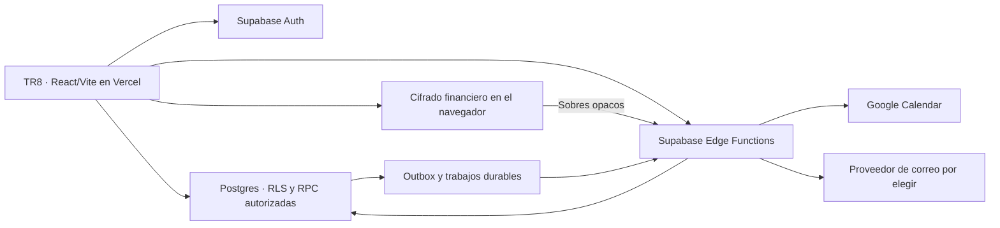

# Arquitectura de TR8 · Contrato de etapa 0

Estado: diseño técnico para las decisiones D01–D18 de [la etapa 0](README.md). Sin cambios de aplicación o infraestructura en esta entrega.

## ADR-TR8-001 · Módulos y alojamiento

Se conserva React + TypeScript + Vite en el proyecto Vercel `tr8`. Supabase Auth mantiene la identidad única y Postgres concentra datos, autorización y trabajos persistentes. Los módulos serán identidad/espacios, equipos/roles, proyectos/tareas, calendario, integraciones y finanzas personales.

No se agrega una segunda identidad Better Auth ni una base Mongo a TR8. Pulso se adapta por contratos, sin copiar su aplicación Vinext completa. Ese cambio de arquitectura financiera requiere demostrar compatibilidad y revisar expresamente el cambio de cookies/origen a la identidad de TR8; [su puerta específica](pulso-adaptation.md) permanece antes de código financiero.

Supabase Edge Functions es la frontera elegida para OAuth, conectores HTTPS, trabajadores y validación financiera opaca. No se ejecuta la derivación de claves privadas en el servidor. Las operaciones de dominio no requieren una función HTTP por cada consulta; Postgres aplica sus contratos y permisos.

La incorporación de librerías y versiones se concretará en cada etapa, con lockfile único npm. Esta decisión no autoriza instalar dependencias ni seleccionar servicios de pago.

## ADR-TR8-002 · Tres fronteras de autorización

1. Espacio personal: únicamente su titular.
2. Equipo/proyecto: membresía activa, permiso acumulado y acceso al proyecto; excepción del propietario solo dentro de su equipo.
3. Bóveda financiera: identidad individual y posesión de medios privados; nunca permiso de equipo.

La posibilidad técnica del operador de administrar infraestructura no equivale a un permiso de producto ni proporciona claves privadas. Supabase Vault se usa para secretos operativos del servidor; no es la bóveda de Pulso ni una sustitución de su cifrado en el navegador.

Los permisos editables son elementos de un catálogo del sistema; no SQL, expresiones ejecutables ni nuevas facultades inventadas por un cliente. No se autorizan por `user_metadata`, nombres de roles, un `workspace_id` enviado o un JWT con permisos antiguos.

La frontera de escritura debe garantizar validación, autorización actual, versión, auditoría/outbox cuando corresponda y resultado atómico. Revocar DML directo implica diseñar wrappers RPC y ejecutores privados mínimos; no basta convertir todas las funciones a `SECURITY DEFINER`. El [contrato de acceso](data-and-access.md) define la estrategia y sus comprobaciones.

## ADR-TR8-003 · Cola durable y ejecución gratuita

La operación de negocio y su acontecimiento se confirman juntos en Postgres. Los trabajos durables pertenecen a tablas ordinarias protegidas; no se considera durable la cola interna no registrada de `pg_net`.

Se propone Supabase Cron para revisar trabajos vencidos y `pg_net` para despertar un trabajador Edge únicamente cuando haya trabajo. El trabajador usa un secreto de servicio específico, no la clave publishable como autorización administrativa. Los secretos no van en SQL público, registros, respuestas o variables `VITE_*`.

El estado del trabajo admite pendientes, reclamados con vencimiento de lease, reintento, resultado confirmado y resultado incierto/fallo que requiere intervención. Se comprueba acceso y revisión al reclamar y antes de revelar datos. El [contrato de calendario y avisos](calendar-and-notifications.md) fija los detalles.

No existe una transacción distribuida con Google o el correo. Una respuesta perdida puede requerir reconciliación; no se promete entrega exactamente una vez. La revocación evita operaciones futuras, pero no puede retirar un correo entregado ni garantizar borrar una copia externa sin autorización.

Los fallos externos nunca revierten un guardado de tarea ya confirmado. Tampoco se mantiene el navegador abierto como requisito para procesos autónomos.

## ADR-TR8-004 · Identidad y acceso de nuevos usuarios

La allowlist única actual se reemplazará mediante migración controlada, sin ampliar el helper existente para aceptar cualquier cuenta.

Propuesta inicial: incorporación por invitación, correo confirmado y comprobación de la cuenta al aceptar. Crear una cuenta de Auth por sí solo no concede membresía ni permite materializar un espacio personal sin la autorización de alta definida. La provisión del espacio personal y aceptación de invitaciones será atómica e idempotente.

Abrir registro público, aceptar invitados externos a proyectos o incorporar SSO empresarial no forma parte de estas etapas. Google Calendar es un consentimiento separado, no una decisión de agregar Google como método de inicio de sesión.

El SMTP de autenticación para destinatarios externos es dependencia de la apertura de colaboración real, aunque los avisos opcionales todavía estén apagados. No se agregan colaboradores como administradores de la organización Supabase para esquivar ese límite.

## ADR-TR8-005 · Compatibilidad, versiones y caché

- Se conservan identificadores y enlaces actuales; el servidor resuelve el espacio del proyecto después de autorizar la consulta.
- Las peticiones nuevas especifican su ámbito y contrato; nunca se obtiene acceso por inferencia del creador.
- El cambio de política no permite que un bundle antiguo descargue todo el equipo. Operaciones incompatibles devuelven un error de actualización requerida antes de escribir.
- Las claves de caché incluyen usuario, espacio, proyecto y filtros. Logout/cambio de identidad limpia todo; revocaciones invalidan consultas y borradores afectados. Los datos ya vistos o copiados no pueden retirarse del dispositivo con garantía.
- Se conserva versión esperada y conflicto visible, sin sobrescritura silenciosa ni edición colaborativa de texto tipo documento.
- Consultas por cursor/ventana temporal, refoco y cambios confirmados. Realtime solo se añadirá con filtrado y presupuesto comprobados; no se requiere para que el aislamiento sea correcto.
- Preservar datos requiere ensayar copia/restauración y migración en entorno aislado antes de aplicar cambios reales. Una reversión no puede restablecer una antigua autorización sobre datos nuevos compartidos.

## ADR-TR8-006 · Condiciones para coste cero

Se utiliza el proyecto gratuito existente, sin abrir trials, agregar medios de pago ni habilitar recursos facturables. Las cuotas publicadas y los objetivos internos son diferentes y se registran en [presupuesto](free-tier-budget.md).

El cron Hobby de Vercel no es el planificador de avisos frecuentes. Los correos requieren un proveedor/remitente por elegir; la comprobación de una cuota gratuita no prueba que ya esté configurado. No se promete gratuidad ilimitada ni continuidad operativa propia de un plan con SLA.

La colaboración dentro de TR8 no incorpora colaboradores al equipo de desarrollo de Vercel o Supabase. La elegibilidad del alojamiento Hobby para el uso real, especialmente si pasa a ser comercial, se revisará antes de ampliar el despliegue.

## Referencias y cambios recientes

Consultadas 2026-10-23:

- [Supabase RLS](https://supabase.com/docs/guides/database/postgres/row-level-security).
- [Planificación de Edge Functions](https://supabase.com/docs/guides/functions/schedule-functions).
- [pg_net](https://supabase.com/docs/guides/database/extensions/pg_net): HTTP posterior al commit, cola no registrada y API beta; revalidar firmas al implementar.
- [Límites Edge](https://supabase.com/docs/guides/functions/limits): implican correo mediante API HTTPS y trabajos cortos.
- [Cron Hobby](https://vercel.com/docs/cron-jobs/usage-and-pricing).
- [Changelog Supabase](https://supabase.com/changelog): índice leído como Markdown mediante solicitud HTTP de solo lectura. La retirada de [cifrados TLS antiguos](https://supabase.com/changelog/cbc-tls-ciphers-deprecated) desde noviembre exige probar navegadores soportados, no debilitar TLS. El cambio de [Postgres 15.19/17.11](https://supabase.com/changelog/postgres-15-19-17-11-breaking-changes) se tendrá en cuenta si se incorporan índices/extensiones afectados; no se realiza actualización ni reindexación en etapa 0. No se emplean los adaptadores de `@supabase/server` anunciados como obsoletos.
